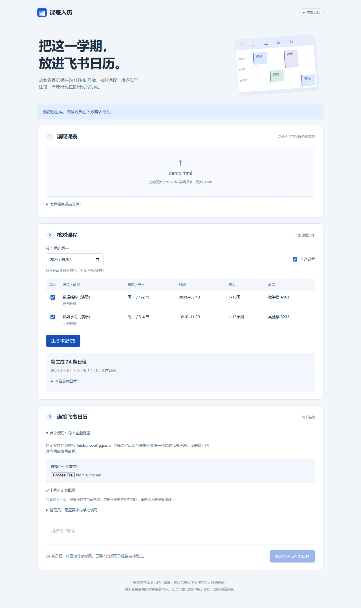

# 课表入历

把教务系统保存的 HTML 课表，导入自己授权的飞书日历。

**本机运行 · Python 标准库 · 无需 pip / npm · 无数据库**

支持课程选择、周次与单双周、连续节次、教师与教室、北京时间换算、逐条日程预览、用户 OAuth 授权、可写日历选择、重复导入检查与实时进度。



## 1. 启动（约一分钟）

1. 安装 [Python 3.10 或更新版本](https://www.python.org/downloads/)。Windows 安装时勾选 **Add Python to PATH**。
2. 下载本项目 ZIP 并解压到普通文件夹。
3. Windows 双击 **start.bat**；macOS / Linux 在项目目录运行 `sh start.sh`。
4. 浏览器自动打开 [http://127.0.0.1:8765](http://127.0.0.1:8765)。保持启动窗口运行，关闭它会停止服务。

也可在项目目录执行：

```sh
python app.py
```

先上传 `examples/demo.html` 即可体验解析和预览，无需任何账号。示例为虚构数据，没有学生个人信息。

## 2. 成员首次使用：导入企业配置

企业内部共用管理员已经创建的**同一个飞书应用**。成员不需要创建应用，也不需要服务器或常开主机；仅在使用时运行本机程序即可。

1. 从 GitHub 下载程序，按上一节启动。
2. 向企业管理员领取单独发放的 **feishu-config.json**。
3. 在「连接飞书日历 → 首次使用：导入企业配置」选择该 JSON 文件。
4. 看到「企业配置已保存」后，点击「授权飞书账号」，用**自己的账号**完成授权。
5. 此后同一安装目录无需重复导入配置；重启程序后重新授权自己的账号即可。管理员更换密钥时，重新导入新的配置文件。

配置仅保存到本机 `.local/config.json`，不会回显密钥。错误配置不会覆盖已有配置；更换有效配置会清除旧用户授权和旧日程预览，需要重新授权并生成预览。

### 管理员：准备应用与内部配置文件

以下只由管理员统一操作，普通成员无需重复做。

1. 打开 [飞书开放平台](https://open.feishu.cn/app)，进入已经创建的**企业自建应用**。
2. 在「凭证与基础信息」找到 **App ID** 和 **App Secret**。
3. 在「权限管理」开通以下**用户身份权限**（只开应用身份权限不够）：

   | 权限 | 用途 |
   | --- | --- |
   | `calendar:calendar:readonly` | 获取可访问日历和日程，用于选日历及重复检查 |
   | `calendar:calendar.event:create` | 以授权用户身份创建课程日程 |

4. 在「安全设置」的重定向 URL 中加入完整地址：

   ```text
   http://127.0.0.1:8765/oauth/callback
   ```

5. 创建版本并发布，根据所在组织要求完成管理员审批，把使用者加入应用可用范围。如果平台要求配置网页应用主页，填写 `http://127.0.0.1:8765`。
6. 复制 `examples/feishu-config.example.json` 模板，填入真实凭证，另存为 **feishu-config.json**：

   ```json
   {
     "app_id": "cli_REPLACE_ME",
     "app_secret": "REPLACE_ME"
   }
   ```

   两个值都要替换；程序会拒绝未填写的示例模板。使用 UTF-8 JSON 格式，不要添加注释或末尾逗号。

7. 通过企业内部渠道单独发放填写好的 `feishu-config.json`。**公开 GitHub 仓库和 Release 只放程序与占位模板，不放真实配置。** `.gitignore` 已排除名为 `feishu-config.json` 的文件及 `*.private.json`；如使用其他文件名，需自行加入忽略规则。

管理员也可在界面的「管理员：配置要求与手动填写」中填写凭证进行本机测试。手动保存不会自动生成企业分发文件，仍按上述模板制作一次即可。

**不同组织的用户**通常需要自行创建本组织内可用的飞书应用，或者使用已按飞书规则发布并向他们开放的应用。将本项目上传 GitHub，并不会自动让一个企业自建应用对所有人开放。如果普通使用者没有创建应用权限，需要由组织管理员准备配置。

本版本仅面向本机使用，不能直接作为 GitHub Pages 静态网页运行。App Secret 由各成员电脑上的本机后端使用；持有内部配置文件的成员能够读取该密钥，这属于本分发方案的信任边界。

## 3. 导入自己的课表

1. 在教务系统打开课表，切换到**学期课表**，等待课程加载完毕。
2. 使用浏览器「另存为」保存 HTML（Ctrl+S / ⌘S）。只上传 `.html` 文件即可，不需要旁边的资源文件夹。
3. 上传到小组件，核对课程、教师、教室、星期、时间和周次。合并后隐藏的单元格会自动去重。
4. 填写学校教学日历中的**第 1 周周一**。系统不会根据文件保存时间推测开学日期。
5. 同一时段的冲突安排默认不勾选。核实后选择正确的安排；若保留冲突课程，需要勾选确认提示。
6. 生成日程预览，查看日期范围和全部日程。
7. 授权飞书，选择有写入权限的主日历或共享日历，点击「确认导入 N 条日程」。建议先使用演示文件或少量课程，在测试日历核对后再完整导入。

所有日程按 **Asia/Shanghai（北京时间，UTC+8）** 写入。每一次上课对应一个独立日程，支持不连续教学周。原课表没有教室的课程会保留为空并提示。

## 支持范围与注意事项

- **支持格式**：当前适配带 `jc` / `xq` 节次与星期属性、`.arrage` 课程块的厦大 / Wisedu 已保存课表。不是通用的任意学校 HTML 识别器；无法识别时会明确报错。
- **周次**：如 `1-16周`、`1-5,8-13,16周`、`9-15单周`、`2-8周(双)`。不识别的周次不会被猜测，会跳过并提示。
- **调课、节假日、补课**：只使用 HTML 明确列出的星期、周次和教室。原文件若同时列出两个教室、只标了“调”但没有具体生效日期，软件无法判断哪条正确。请先在教务系统确认，必要时在飞书里手工调整。
- **重复导入**：写入前以最早课程时间为锚点，分页读取其后的日程，通过本工具的来源标识跳过相同安排；创建请求另带稳定的飞书幂等 key。去重以课程名、教师、地点和具体起止时间为准。无法读取目标日历时不会继续写入。
- **不是持续同步**：重新导入不会自动删除或修改旧日程。课程改名、换教室、改时间后会被视为新安排，旧安排需在飞书中手工调整。不要删除日程描述中的 `schedule-widget:v1:` 标识，否则重复检查将无法识别该条记录；幂等键的保留由飞书决定。
- **失败重试**：请求失败会停止后续写入，展示已完成数量和错误。检查网络、权限或重新授权后，再次生成预览并导入。成功写入的部分会被重复检查跳过。
- **授权期限**：用户 Token 仅存在本机进程内存中，不申请长期离线权限、不自动续期。程序重启或令牌过期后需重新授权。导入时不要关闭启动窗口。
- **浏览器刷新**：同一会话中可恢复已解析课程和任务进度；开学日期与预览需要重新填写生成。关闭服务后会清空课程和令牌。

## 数据保存

| 内容 | 保存位置 |
| --- | --- |
| 飞书 App ID / Secret | 本机 `.local/config.json`，明文文件，已被 Git 忽略 |
| 用户访问令牌、课表解析结果、任务进度 | 本机进程内存 |
| 原始 HTML | 本机内存读取，不落盘、不执行脚本、不加载其外部资源 |
| 用户确认导入的课程 | 通过 HTTPS 写入所选飞书日历 |

服务仅监听 `127.0.0.1`。采用 Host 校验、同源校验、CSRF Token、HttpOnly 会话 Cookie 和内容安全策略；配置文件和源码不会通过 HTTP 暴露。断开连接会清除本机会话令牌；撤回飞书应用授权需要在飞书里操作。

**不要公开分享 `.local/`、真实企业配置、密钥或私人课表。** 企业配置文件只通过内部渠道单独发放。本项目的 `.gitignore` 已排除本机配置、约定名称的内部配置、私有 HTML 和缓存。使用下述打包脚本分享时，只会打包明确列出的源码、演示文件与占位配置模板。

## 上传 GitHub 与分发

将解压后的项目源码放入自己的 GitHub 仓库即可，不需要托管后端。可选择通过 GitHub 网页上传，或在空仓库中执行常规 `git add` / `git commit` / `git push`。

生成适合分享的源码压缩包：

```sh
python package_release.py
```

输出 `dist/schedule-widget.zip`，可作为 GitHub Release 附件上传。企业真实配置不进入该包。成员下载程序、另行领取企业配置后，按第一、二节启动使用。

## 开发与验证

```sh
python -m unittest discover -s tests -v
```

测试覆盖企业配置保存、非法配置拒绝、配置更换清除旧授权、周次、节次合并、缺失教室、日期与时区、冲突提示、OAuth 状态校验、CSRF、静态文件边界、日历权限过滤、分页、重复检查、失败停止和后台任务。GitHub Actions 配置在 Windows / Linux、Python 3.10 / 3.13 上执行；远端 CI 是否通过以仓库运行结果为准。

浏览器验证使用了示例与真实厦大 HTML 的上传、预览和移动端布局。**没有真实飞书应用凭证的环境只验证了接口逻辑与模拟响应，真实授权与写入需要配置应用后联调。**

自定义端口（同时更新飞书安全设置中的回调 URL）：

```sh
python app.py --port 8766
python app.py --no-browser
```

也可通过 `FEISHU_APP_ID` 和 `FEISHU_APP_SECRET` 环境变量提供配置。它们在进程启动时覆盖配置文件；在界面保存配置会更新当前进程和本机配置文件，下次启动仍以环境变量为准。

主要文件：`app.py`（本机服务与 OAuth）、`schedule_parser.py`（解析与展开）、`feishu.py`（飞书 API）、`static/`（界面）、`tests/`（标准库单元与 HTTP 测试）。

## 接口依据

- [飞书：获取用户访问令牌](https://open.feishu.cn/document/authentication-management/access-token/get-user-access-token)
- [飞书：创建日程](https://open.feishu.cn/document/server-docs/calendar-v4/calendar-event/create)
- [飞书：获取日程列表](https://open.feishu.cn/document/server-docs/calendar-v4/calendar-event/list)
- [飞书官方 SDK 的日历请求定义（包含幂等键）](https://github.com/larksuite/oapi-sdk-go/blob/v3_main/service/calendar/v4/model.go)

MIT License。
